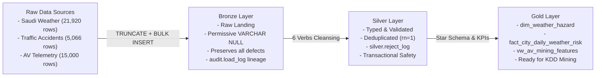

# AV-Ready-Saudi: Data Warehouse & Data Mining Project

**New Mansoura University - Faculty of Computer Science and Engineering**  
**Course:** Data Mining & Data Warehousing  
**Project:** Autonomous Vehicles (AV) Environmental Readiness, Route Risk & Safety in Saudi Arabia  

---

## 1. Project Purpose & Analytical Questions
The objective of **AV-Ready-Saudi** is to build a robust, reproducible, multi-tier data warehouse and feature store assessing whether and where autonomous vehicles can operate safely in the Kingdom of Saudi Arabia.

The core research questions:
1. **Sensor & Environmental Hazard**: How do sandstorms, dust, extreme heat (>45°C), and reduced visibility impact LiDAR and camera perception across major Saudi urban corridors?
2. **Accident Correlation**: What are the geographical distributions of traffic incident densities, and how do they correlate with regional weather anomalies?
3. **Operational Classification**: Which Saudi cities and months qualify as *Optimal*, *Moderate Risk*, or *High Risk* for autonomous driving?

---

## 2. Architectural Blueprint (Medallion Model)



---

## 3. Repository Structure
Organized strictly in accordance with Unit 1, Unit 2, and Unit 3 course conventions:

```text
AV-Ready-Saudi/
├── .gitignore                      <-- Excludes heavy raw files & point clouds
├── README.md                       <-- Reproduction contract & execution guide
├── docs/                           <-- System documentation & academic deliverables
│   ├── 01_architecture_overview.md  <-- Pipeline & KDD alignment
│   ├── 02_data_dictionary.md       <-- Detailed attribute taxonomy & types
│   ├── 03_readiness_memo.md        <-- "Ready for Mining" evidence memo
│   └── 04_team_collaboration_guide.md <-- Git workflow for teammates
├── sql/
│   ├── ddl/                        <-- Schema & Table initialization scripts
│   │   ├── 01_init_database.sql
│   │   ├── 02_create_audit_tables.sql
│   │   ├── 03_create_bronze_tables.sql
│   │   ├── 04_create_silver_tables.sql
│   │   └── 05_create_gold_views_tables.sql
│   ├── bronze/                     <-- Automated batch full-load procedure
│   │   └── proc_load_bronze.sql
│   ├── silver/                     <-- 6 Verbs transformation & deduplication
│   │   └── proc_load_silver.sql
│   ├── gold/                       <-- Star schema & fact loading procedure
│   │   └── proc_load_gold.sql
│   └── quality/                    <-- Quality gates & reconciliation checks
│       ├── 01_bronze_validation.sql
│       └── 02_silver_reconciliation.sql
├── python/                         <-- Python profiling & machine learning models
└── tests/                          <-- Data integration tests
```

---

## 4. Data Sources & Download Link
The datasets required for this project are hosted on Google Drive:
* **Google Drive Dataset Repository**: [Download AV-Ready-Saudi Data Folder](https://drive.google.com/drive/folders/1ehqYZj7pMf8gUf-10DxyHAhyGpUt86tH)

Place the extracted files inside the local `Data/` folder:
* `Data/saudi_weather_daily_2019_2024.csv` (21,920 rows - Open-Meteo Historical Archive across 10 Saudi cities)
* `Data/saudi_traffic_accidents_2019_2024.csv` (5,066 rows - Saudi Highway Traffic Safety & Incident Records)
* `Data/av_telemetry_failures_saudi.csv` (15,000 rows - AV Fleet Telemetry & Environmental Sensor Failures)

---

## 5. How to Reproduce the Pipeline (Execution Contract)

Run the SQL scripts in order using **SQL Server Management Studio (SSMS)** or `sqlcmd`:

### Step 1: Initialize Database & Schemas
```sql
-- Creates database av_ready_saudi_dw with bronze, silver, gold, audit, quality schemas
:r sql/ddl/01_init_database.sql
:r sql/ddl/02_create_audit_tables.sql
:r sql/ddl/03_create_bronze_tables.sql
:r sql/ddl/04_create_silver_tables.sql
:r sql/ddl/05_create_gold_views_tables.sql
```

### Step 2: Ingest Bronze Layer (Raw Landing)
```sql
:r sql/bronze/proc_load_bronze.sql
EXEC bronze.load_bronze @base_path = 'D:\AV-Ready-Saudi\Data';
```
*Validation*: Run `sql/quality/01_bronze_validation.sql` to verify expected vs. loaded counts (`MATCH`).

### Step 3: Transform Silver Layer (Cleansing & Deduplication)
```sql
:r sql/silver/proc_load_silver.sql
EXEC silver.load_silver;
```
*Reconciliation Proof*: Run `sql/quality/02_silver_reconciliation.sql` to verify:
$$\text{Bronze Rows} = \text{Silver Rows} + \text{Rejected Rows} + \text{Duplicates} \quad (\text{BALANCED})$$

### Step 4: Build Gold Layer (Analytical Feature Store)
```sql
:r sql/gold/proc_load_gold.sql
EXEC gold.load_gold;
```
*Verify Feature View*:
```sql
SELECT TOP 10 * FROM gold.vw_av_mining_features ORDER BY total_recorded_days DESC;
```

---

## 6. Team Collaboration Guidelines
* Never commit heavy LiDAR `.pcd` point clouds or database backups to GitHub.
* Pull latest updates before branching: `git pull origin main`.
* Create feature branches for each task: `git checkout -b feature/name`.
* For full onboarding steps, refer to `docs/04_team_collaboration_guide.md`.
