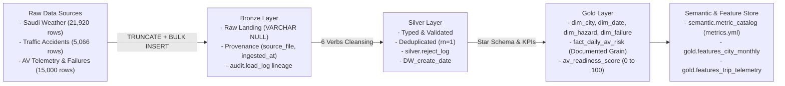

# AV-Ready-Saudi: Data Warehouse & Data Mining Project

**New Mansoura University — Faculty of Computer Science and Engineering**  
**Course:** Data Mining & Data Warehousing (Fall 2026)  
**Project:** Autonomous Vehicles (AV) Environmental Readiness, Route Risk & Safety in Saudi Arabia  
**Lead & Author:** Farahat Saafan & Project Team  
**GitHub Repository:** [github.com/farahatsaafan/AV-Ready-Saudi](https://github.com/farahatsaafan/AV-Ready-Saudi)  
**Google Drive Datasets:** [AV-Ready-Saudi Official Google Drive Folder](https://drive.google.com/drive/u/0/folders/1ehqYZj7pMf8gUf-10DxyHAhyGpUt86tH)  

---

## 1. Project Purpose & Analytical Questions (Idea Questions)
The objective of **AV-Ready-Saudi** is to build an enterprise, multi-tier data warehouse and feature store assessing whether and where autonomous vehicles can operate safely in the Kingdom of Saudi Arabia.

The core research questions:
1. **Sensor & Environmental Hazard**: How do sandstorms, dust, extreme heat (>45°C), and high solar radiation impact LiDAR and optical camera perception across major Saudi urban corridors?
2. **Accident Correlation**: What are the geographical distributions of traffic incident densities, and how do they correlate with regional weather anomalies on national highway corridors (Highways 40, 65, 15)?
3. **Operational Classification**: Which Saudi cities and months qualify as *Optimal*, *Moderate Risk*, or *High Risk* for autonomous driving?
4. **Disengagement Probability**: What is the empirical likelihood of autonomous disengagement (`av_disengagement = True`) under varying atmospheric degradation thresholds?

---

## 2. Project Deliverables Matrix (Matching Course Checklist)

| Deliverable Item | Project Location / Artifact | Description & Status |
| :--- | :--- | :--- |
| **1. Sources links & datasets** | `Data/` & `docs/data_source_register.csv` | 6 datasets in `Data/` (Weather, Accidents, Master Telemetry + 3 Specialized Benchmarks) |
| **2. Idea question** | `docs/PROJECT_SPEC.md` & `README.md` | Formal problem statement, business questions, and target entities |
| **3. Bronze Sql script** | `sql/01_bronze.sql` | Raw landing tables, provenance tracking (`source_file`, `ingested_at`), load views, and `bronze.load_bronze` |
| **4. Bronze database** | Database: `av_ready_saudi_dw` \| `bronze.*` | `bronze.sa_weather`, `bronze.sa_traffic_accidents`, `bronze.av_telemetry` |
| **5. Bronze report** | `docs/reports/01_bronze_report.md` | Complete Bronze layer report: volumes, permissive schema rules, provenance, and defects profile |
| **6. Silver Sql script** | `sql/02_silver.sql` | 6-verbs transformation, strong typing, `silver.reject_log`, `DW_create_date`, and `silver.load_silver` |
| **7. Silver database** | Database: `av_ready_saudi_dw` \| `silver.*` | `silver.sa_weather`, `silver.sa_traffic_accidents`, `silver.av_telemetry`, `silver.reject_log` |
| **8. Silver report** | `docs/reports/02_silver_report.md` | Complete Silver layer report: 6 verbs execution, reject log analysis, and mathematical reconciliation gate |
| **9. Gold Script** | `sql/03_gold.sql` | Star Schema dimensional DDL (`dim_*`, `fact_*` with grain), readiness KPI, and `gold.load_gold` |
| **10. Gold database** | Database: `av_ready_saudi_dw` \| `gold.*` | `dim_city`, `dim_date`, `dim_weather_hazard`, `dim_av_failure_type`, `fact_daily_av_risk` |
| **11. Gold report** | `docs/reports/03_gold_report.md` | Complete Gold layer report: dimensional modeling, documented grain, and readiness scoring formula |

---

## 3. Architectural Blueprint (Medallion Model)



---

## 4. Repository Structure
Organized strictly in accordance with the official Course Project Skeleton (Fall 2026):

```text
AV-Ready-Saudi/
├── .gitignore                      <-- Excludes raw heavy files & local zip archives
├── .env.example                    <-- Database connection template
├── requirements.txt                <-- Python dependencies (SQLAlchemy, pyodbc, scikit-learn)
├── README.md                       <-- Project reproduction contract & deliverables guide
├── docs/                           <-- Course documentation & academic governance
│   ├── PROJECT_SPEC.md             <-- Comprehensive project specification
│   ├── data_source_register.csv    <-- Detailed data provenance registry
│   ├── data_dictionary.csv         <-- Standard enterprise data dictionary
│   ├── naming_conventions.md       <-- Database & code naming standards
│   ├── reports/                    <-- Formal layer reports
│   │   ├── 01_bronze_report.md     <-- Bronze layer profile & ingestion report
│   │   ├── 02_silver_report.md     <-- Silver layer 6-verbs & reconciliation report
│   │   └── 03_gold_report.md       <-- Gold layer dimensional Star Schema report
│   ├── 01_architecture_overview.md
│   ├── 02_data_dictionary.md
│   ├── 03_readiness_memo.md
│   └── 04_team_collaboration_guide.md
├── Data/                           <-- Local data directory (Downloaded from Google Drive)
│   ├── saudi_weather_daily_2019_2024.csv          <-- 21,920 rows (Open-Meteo Historical Archive)
│   ├── saudi_traffic_accidents_2019_2024.csv      <-- 5,066 rows (GASTAT / Ministry of Transport)
│   ├── av_telemetry_failures_saudi.csv            <-- 15,000 rows (Consolidated AV Fleet Telemetry)
│   ├── saudi_av_sensor_dust_storm_failures.csv    <-- 6,000 rows (Dust Storm & LiDAR Attenuation)
│   ├── saudi_av_thermal_overheat_failures.csv     <-- 6,000 rows (Thermal Throttling & Compute Stress)
│   ├── saudi_av_tire_pressure_blowout_failures.csv<-- 6,000 rows (Asphalt Heat & Tire Delamination)
│   └── AV_Ready_Saudi_All_Datasets.zip            <-- All 6 CSVs compressed for Google Drive sync
├── sql/                            <-- Sequential SQL Server scripts
│   ├── 00_init.sql                 <-- Database, 6 schemas, and audit.load_log
│   ├── 01_bronze.sql               <-- Bronze landing tables, load views, proc_load_bronze
│   ├── 02_silver.sql               <-- Silver trusted tables, reject_log, proc_load_silver
│   ├── 03_gold.sql                 <-- Gold dimensional Star Schema & fact_daily_av_risk
│   ├── 04_semantic.sql             <-- Semantic metric catalog & analytical views
│   ├── 05_feature_views.sql        <-- Documented feature views for data mining
│   └── 06_analytics.sql            <-- Core business analytical queries
├── semantic/                       <-- Semantic layer metric configurations
│   └── metrics.yml                 <-- Standard business metric definitions
└── tests/                          <-- Data integration & quality tests
```

---

## 5. Data Sources & Google Drive Repository
The complete datasets are hosted on the official Google Drive folder:
* 🔗 **Google Drive Dataset Repository**: [Download AV-Ready-Saudi Data Folder](https://drive.google.com/drive/u/0/folders/1ehqYZj7pMf8gUf-10DxyHAhyGpUt86tH)

Place the extracted files inside the local `Data/` folder:
1. `Data/saudi_weather_daily_2019_2024.csv` (21,920 rows)
2. `Data/saudi_traffic_accidents_2019_2024.csv` (5,066 rows)
3. `Data/av_telemetry_failures_saudi.csv` (15,000 rows)
4. `Data/saudi_av_sensor_dust_storm_failures.csv` (6,000 rows)
5. `Data/saudi_av_thermal_overheat_failures.csv` (6,000 rows)
6. `Data/saudi_av_tire_pressure_blowout_failures.csv` (6,000 rows)

---

## 6. How to Reproduce the Warehouse Pipeline (Execution Contract)

Run the SQL scripts in order using **SQL Server Management Studio (SSMS)** or `sqlcmd`:

### Step 1: Initialize Database & Schemas
```sql
:r sql/00_init.sql
```

### Step 2: Ingest Bronze Layer (Raw Landing & Provenance)
```sql
:r sql/01_bronze.sql
EXEC bronze.load_bronze @base_path = 'D:\AV-Ready-Saudi\Data';
```

### Step 3: Transform Silver Layer (Cleansing, Deduplication & Reject Log)
```sql
:r sql/02_silver.sql
EXEC silver.load_silver;
```
*Mathematical Reconciliation Check:*
$$\text{Bronze Rows} = \text{Silver Rows} + \text{Reject Log Rows} + \text{Duplicates} \quad (\text{BALANCED})$$

### Step 4: Build Gold Layer (Dimensional Star Schema)
```sql
:r sql/03_gold.sql
EXEC gold.load_gold;
```
*Verify Fact Grain & Readiness Score:*
```sql
SELECT TOP 10 c.city_name_en, d.calendar_date, f.av_readiness_score, f.daily_disengagements_count
FROM gold.fact_daily_av_risk f
JOIN gold.dim_city c ON f.city_key = c.city_key
JOIN gold.dim_date d ON f.date_key = d.date_key
ORDER BY f.av_readiness_score ASC;
```
