# AV-Ready-Saudi — Architecture Overview

One-page summary of the warehouse. The full design (relations, rules, lineage, data shares, limitations) is in
[05_relations_and_lineage.md](05_relations_and_lineage.md); every column is in
[02_data_dictionary.md](02_data_dictionary.md).

## 1. Question

How ready is each Saudi region, by season, for autonomous vehicles? No AVs operate in Saudi Arabia yet, so AV evidence
comes from US records (NHTSA crashes, California DMV disengagements and mileage) and is transferred through one weather
vocabulary measured the same way in both places (`silver.dim_condition`: dust, dry haze, moist fog, rain, normal; day /
night). Dust has no US AV evidence and counts as uncovered. Accidents are compared as rates per 100,000 people, next to
monthly traffic, the road network and ambulance response times. All data is real (0 % generated).

## 2. Layers

```mermaid
flowchart LR
  RAW["Data/raw<br/>NOAA · GASTAT · census · DMV · NHTSA"] -->|python/00_land_raw.py<br/>format only| LAND["Data/landing/*.tsv"]
  LAND -->|bronze.load_bronze<br/>BULK INSERT| BR["Bronze<br/>6 raw tables, all text"]
  BR -->|silver.load_silver<br/>type · clean · dedupe · reject| SI["Silver<br/>9 clean tables + reject_log<br/>+ 6 reference tables + fn_day_type"]
  SI -->|gold.load_gold<br/>aggregate · relate| PR["prep<br/>4 work tables"]
  PR --> GO["Gold<br/>gold.av_readiness_region_month<br/>13 regions × 60 months"]
  GO --> ML["EDA (sql/04_analysis.sql) + models<br/>(python/05_readiness_model.py)<br/>readiness score per region × season"]
```

| Layer | Schema | Objects | Rule |
|---|---|---|---|
| Bronze | `bronze` | `noaa_hourly`, `gastat_cells`, `dmv_disengagements`, `dmv_mileage`, `nhtsa_sgo_ads`, `gastat_population` | values verbatim as text, plus source file, row number and batch id |
| Silver | `silver` | `weather_obs`, `accidents_region_year`, `roads_region_year`, `population_region_year`, `traffic_region_month`, `region_service_2025`, `dmv_disengagement`, `dmv_mileage_monthly`, `nhtsa_crash`, `reject_log`; reference `dim_region`, `dim_station`, `dim_condition`, `region_alias`, `gastat_sheet_map`, `gastat_traffic_map`; function `fn_day_type` | typed, cleaned, deduplicated; every dropped row is rejected with a reason or removed by a documented rule |
| prep | `prep` | `weather_station_hour`, `weather_station_day`, `saudi_region_month`, `av_relative_risk` (Mantel–Haenszel, 95 % CI, evidence rule) | intermediate aggregation, used only to build Gold |
| Gold | `gold` | `av_readiness_region_month` (the only table) | grain region × month, 2021–2025 |
| Audit | `audit` | `load_log`, `dq_result` | one row per load step / per quality check |

## 3. Relations

18 declared foreign keys (diagram: [07_erd.md](07_erd.md)).

* Weather, traffic, roads, population, service ↔ accidents / Gold: same `region_code` and year (or month).
* Weather ↔ AV events: `silver.dim_condition` — every hour bucket, day type, NHTSA category and relative-risk row is a
  foreign key to it.
* AV events ↔ US weather: state × incident month (crashes), date × weekday class weighted by fleet miles
  (disengagements); the evidence-backed ratios are applied to each Saudi region-month's own condition mix.

## 4. Quality gates

`sql/quality/01_bronze_validation.sql` (row counts vs landing files), `02_silver_reconciliation.sql` (every Bronze row
accounted for, national accident totals equal GASTAT, traffic totals equal GASTAT's national row, implied populations
reproduce GASTAT's published rates, v2 weather shares), `03_gold_checks.sql` (one Gold table, 780 unique rows, FKs
trusted, shares sum to 1, no constant column, every source reaches Gold, three data-share views),
`04_rollback_demo.sql` (a forced failure leaves Silver unchanged). `python/02_reference_gold.py` rebuilds Silver / prep /
Gold independently with pandas and compares the exported SQL Gold column by column.

## 5. Run

macOS: `SA_PASSWORD='...' bash run_pipeline_mac.sh` · Windows: `.\run_pipeline.ps1`. Setup steps for the team:
[04_team_collaboration_guide.md](04_team_collaboration_guide.md).
