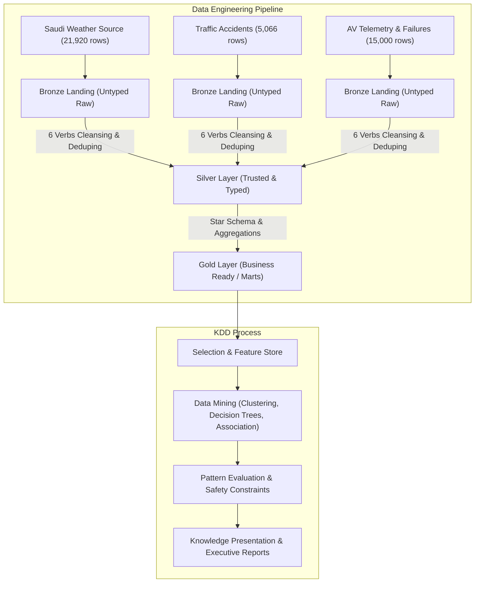

# AV-Ready-Saudi: Data Architecture Overview

## 1. Project Mission & Analytical Scope
**AV-Ready-Saudi** is an enterprise data warehousing and data mining initiative designed to assess the environmental readiness, route safety, and sensor viability for Autonomous Vehicles (AV) across the Kingdom of Saudi Arabia.

The core research question addresses:
> *"How do regional climate extremes (dust storms, ambient heat >45°C, reduced visibility) and historical accident densities constrain or enable autonomous driving operations in Saudi urban corridors?"*

---

## 2. KDD vs. Data Engineering Alignment
Following the course curriculum (Unit 1, Lesson 1.1), the architecture distinguishes between:
* **Data Engineering Pipeline**: The deterministic, reproducible delivery of reliable data products (schemas, DDL scripts, transactional procedures, reconciliation gates).
* **KDD (Knowledge Discovery in Databases)**: The iterative discovery of non-trivial, actionable patterns (clustering regional risks, classifying driving regimes, evaluating sensor hazard rules).

---

## 3. The Medallion Architecture Principles

### A. Bronze Layer (Raw Landing)
* **Goal**: Verbatim preservation of source files with minimal interpretation.
* **Storage Schema**: `bronze.*`
* **Permissive Typing**: All incoming fields are stored as `VARCHAR` / `NVARCHAR(MAX)` with `NULL` permitted to ensure zero load failures during raw ingestion.
* **Full-Load Semantics**: Repeatable batch full loading via `TRUNCATE TABLE` followed by `BULK INSERT` with `CODEPAGE = '65001'` (UTF-8).
* **Technical Lineage**: All batch runs are tracked in `audit.load_log` recording `batch_id` (GUID), execution timestamps, loaded counts, and operational status.

### B. Silver Layer (Cleaned & Trusted)
* **Goal**: Enforcement of enterprise quality rules, strong typings, deduplication, and referential integrity.
* **Storage Schema**: `silver.*`
* **The Six Core Verbs**:
  1. **Trim**: Strip leading/trailing whitespaces (`NULLIF(TRIM(col), '')`).
  2. **Standardize**: Canonical casing (`UPPER`), code consolidation, and metric normalization.
  3. **Convert**: Safe conversion to concrete types (`DATE`, `INT`, `DECIMAL`, `BIT`) via `TRY_CONVERT`.
  4. **Deduplicate**: Window function `ROW_NUMBER() OVER (PARTITION BY ... ORDER BY ... ASC)` retaining the primary surviving version (`rn = 1`).
  5. **Validate & Reject**: Mandatory attribute violations are quarantined into `silver.reject_log` with actionable diagnostic reasons.
  6. **Transactional Atomicity**: Encapsulated within `BEGIN TRAN ... COMMIT / ROLLBACK` with `SET XACT_ABORT ON`.
* **Reconciliation Equality**:
  $$\text{Bronze Rows} = \text{Silver Rows} + \text{Rejected Rows} + \text{Duplicates}$$

### C. Gold Layer (Business Marts & Mining Features)
* **Goal**: Dimensional star schema and analytical feature views.
* **Storage Schema**: `gold.*`
* **Key Artifacts**:
  * `gold.dim_weather_hazard`: Autonomous vehicle sensor impact taxonomy (LiDAR beam attenuation, optical camera occlusion).
  * `gold.dim_city`: Geographic dimensions and coordinates across 10 major Saudi regions.
  * `gold.dim_av_failure_type`: Catalog of AV failure categories and severity ratings.
  * `gold.fact_city_daily_weather_risk`: Daily consolidated safety index (`av_readiness_score`), extreme heat flags, and sensor hazard indicators.
  * `gold.vw_av_mining_features`: Model-ready tabular feature set for KDD algorithms (Clustering, Classification, Association Rules).
