# AV-Ready-Saudi — Architecture Overview

One-page summary of the warehouse. The full design (relations, rules, lineage, data shares, limitations) is in
[05_relations_and_lineage.md](05_relations_and_lineage.md); every column is in
[02_data_dictionary.md](02_data_dictionary.md).

## 1. Question

How ready is each Saudi region, month by month, for autonomous vehicles, judged by the environmental conditions
AVs would meet there? No AVs operate in Saudi Arabia yet, so AV behaviour is learned from US records (California
DMV, NHTSA) and transferred through the conditions both places share: rain, obscured (dust / haze / fog /
visibility < 5 km), normal, and day / night. All data is real (0 % generated).

## 2. Layers

```mermaid
flowchart LR
  RAW["Data/raw<br/>NOAA · GASTAT · DMV · NHTSA"] -->|python/00_land_raw.py<br/>format only| LAND["Data/landing/*.tsv"]
  LAND -->|bronze.load_bronze<br/>BULK INSERT| BR["Bronze<br/>5 raw tables, all text"]
  BR -->|silver.load_silver<br/>type · clean · dedupe · reject| SI["Silver<br/>5 clean tables + reject_log<br/>+ 4 reference tables"]
  SI -->|gold.load_gold<br/>aggregate · relate| PR["prep<br/>4 work tables"]
  PR --> GO["Gold<br/>gold.av_readiness_region_month<br/>13 regions × 60 months"]
  GO --> ML["EDA + ML<br/>readiness score per region / season"]
```

| Layer | Schema | Objects | Rule |
|---|---|---|---|
| Bronze | `bronze` | `noaa_hourly`, `gastat_cells`, `dmv_disengagements`, `dmv_mileage`, `nhtsa_sgo_ads` | values verbatim as text, plus source file, row number and batch id |
| Silver | `silver` | `weather_obs`, `accidents_region_year`, `dmv_disengagement`, `dmv_mileage_monthly`, `nhtsa_crash`, `reject_log`; reference `dim_region`, `dim_station`, `region_alias`, `gastat_sheet_map` | typed, cleaned, deduplicated; every dropped row is rejected with a reason or removed by a documented rule |
| prep | `prep` | `weather_station_hour`, `weather_station_day`, `saudi_region_month`, `av_relative_risk` | intermediate aggregation, used only to build Gold |
| Gold | `gold` | `av_readiness_region_month` (the only table) | grain region × month, 2021–2025 |
| Audit | `audit` | `load_log`, `dq_result` | one row per load step / per quality check |

## 3. Relations

* Weather ↔ accidents: same `region_code` and year (both Saudi, observed).
* Weather ↔ AV events: one condition vocabulary (normal / rain / obscured, day / night).
* AV events ↔ US weather: same state and date, giving the exposure for the relative risks; the risks are applied
  to each Saudi region-month's own condition mix.

## 4. Quality gates

`sql/quality/01_bronze_validation.sql` (row counts vs landing files), `02_silver_reconciliation.sql` (every Bronze
row accounted for, national accident totals equal GASTAT), `03_gold_checks.sql` (one Gold table, 780 unique rows,
every source reaches Gold, data shares), `04_rollback_demo.sql` (a forced failure leaves Silver unchanged).
`python/02_reference_gold.py` rebuilds Silver / Gold independently with pandas to compare the counts.

## 5. Run

macOS: `SA_PASSWORD='...' bash run_pipeline_mac.sh` · Windows: `.\run_pipeline.ps1`. Setup steps for the team:
[04_team_collaboration_guide.md](04_team_collaboration_guide.md).
