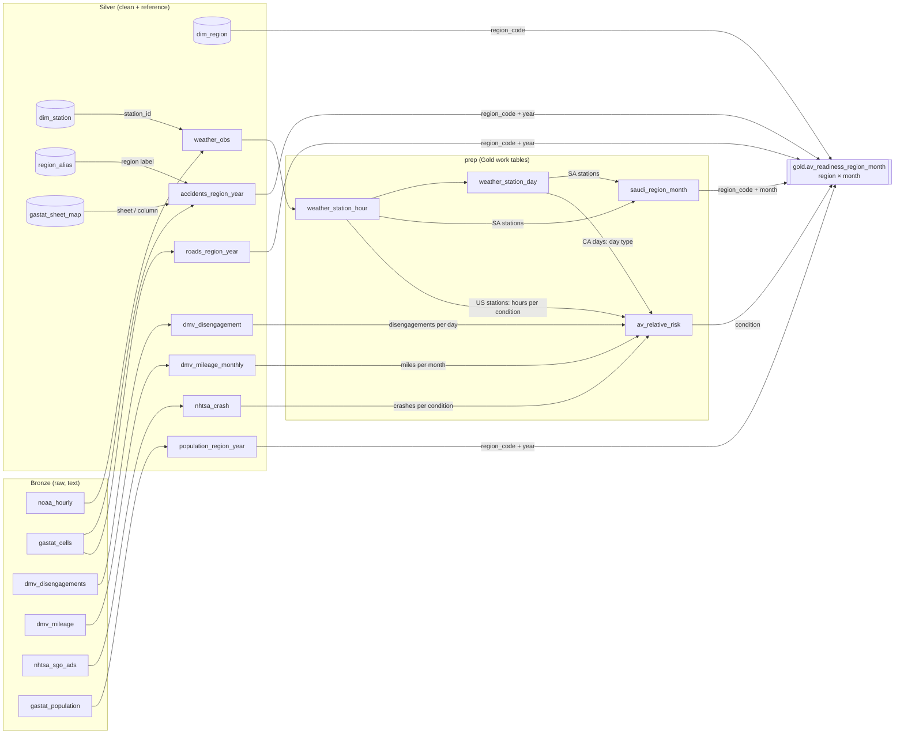

# AV-Ready-Saudi — Relations, Lineage and Data Shares

Status: design of 24 Nov 2026 (branch `dev-ali-ezzat`). Replaces the earlier design that used generated telemetry.
All data in this design is **real** (0 % generated).

## 1. Question and output

**Question.** How ready is each Saudi region, month by month, for autonomous vehicles (AVs), judged by the
environmental conditions AVs actually meet there?

**Output (Gold).** One table, `gold.av_readiness_region_month` — one row per Saudi administrative region per
calendar month, 2021–2025 (13 × 60 = 780 rows). The machine-learning step turns it into a readiness score per
region and season, with the conditions that drive the score (SHAP).

The result is an **evidence-based estimate**, not a measurement: no AVs drive in Saudi Arabia yet, so AV behaviour
is learned in the US and transferred through the conditions both places share.

## 2. Sources

| # | Family | Source | Period | Grain | Origin | Role |
|---|---|---|---|---|---|---|
| 1 | Weather | NOAA NCEI Global Hourly (ISD) — 13 Saudi airport stations, one per region | 2021 – Aug 2025 | one weather report (≈ hourly) | Saudi (observed in KSA, archived by NOAA) | condition mix of each region-month |
| 2 | Weather | NOAA NCEI Global Hourly — LAX, SFO (CA), PHX (AZ), AUS (TX) | 2021 – Aug 2025 | one weather report | US | exposure: how often each condition occurs where the AV events happen |
| 3 | Accidents | GASTAT Land/Road Transport Statistics workbooks 2022, 2023, 2024, 2025 (source: Ministerial Committee for Traffic Safety) | 2021–2025 | region × year | Saudi | serious accidents, deaths, injuries, within/outside cities |
| 4 | AV failures | California DMV AV disengagement reports (drivered, driverless, first-time filers) | Dec 2020 – Nov 2024 | one disengagement | US | events + cause text |
| 5 | AV failures | California DMV AV mileage reports | Dec 2020 – Nov 2024 | vehicle × month | US | exposure (fleet miles) |
| 6 | AV crashes | NHTSA Standing General Order — ADS incident reports (2021–2025 archive + current file) | 2021–2025 used | one crash report | US | events with structured weather / lighting / road type |
| 7 | Roads | GASTAT road network tables (same workbooks as #3): density per person and per km², intercity length by road type | 2022–2025 | region × year | Saudi | road context of each region |
| 8 | Population | GASTAT Saudi Census 2022 — population 2010–2022 by region, nationality and gender | 2021–2022 used (2022 also for 2023–2025) | region × year | Saudi | denominator of accident rates per 100,000 |

Considered and not used (not in the data bundle): KAPSARC 2016–2019 (outside the period),
UK STATS19, Open-Meteo and CAMS model output (modelled, not observed), Saudi Open Data portal files
(annual totals already covered by GASTAT, or too small), OSM extract.

## 3. Relation diagram



### The relations

| Relation | Join key | Kind |
|---|---|---|
| Weather ↔ Accidents | `region_code` + `year` | direct, both Saudi and observed (accidents are annual, so the 12 months of a year carry the same accident values) |
| Weather ↔ AV events | the **condition vocabulary**: `normal`, `rain`, `fog_haze` (fog, haze, mist or visibility < 5 km without dust), `dust` and `day` / `night` (sun position) | each AV event is classified with the same rules as each Saudi weather hour |
| Roads ↔ Accidents | `region_code` + `year` | both GASTAT; road network context of the region |
| Population ↔ Accidents | `region_code` + `year` (2023–2025 use the 2022 census count) | turns accident counts into rates per 100,000 so regions of different size can be compared |
| AV crashes ↔ US weather | `us_state` (CA→LAX+SFO, AZ→PHX, TX→AUS) | exposure for the crash relative risk |
| AV disengagements ↔ CA weather ↔ mileage | `date` (event day ↔ CA day type) and `month` (mileage) | exposure for the disengagement relative risk |

Accidents and AV events are **not** joined row to row — they are different things in different countries. They meet
in Gold through weather: same region-month row, same condition vocabulary.

## 4. Rules

**Weather report → condition flags (Silver).** WMO present-weather codes from manual (`MW1`, WMO 4677) and automated
(`AW1`, WMO 4680) reports and the METAR-style group (`AU1`):

| Flag | Rule |
|---|---|
| dust | MW 06–09 or 30–35; AU obscuration DU/SA; AU other dust/sand whirls, sandstorm, duststorm |
| haze / smoke | MW 04–05; AW 04–05; AU obscuration FU/HZ |
| fog | MW 40–49; AW 30–35; AU obscuration FG |
| rain | MW 50–69 or 80–99; AW 40–69 or 80–89; AU precipitation DZ/RA/UP; measured 1-hour precipitation > 0 |
| low visibility | visibility < 5 000 m (quality codes 2/3/6/7 discarded) |
| night | solar elevation < −0.833° (NOAA solar-position equations) |

Daily/monthly summary records (`SOD`, `SOM`) are not observations and are removed; duplicate reports
(same station, timestamp and report type) are removed.

**Hour bucket (Gold).** dust › fog_haze (haze / fog / low visibility without dust) › rain › normal.
**Day type (Gold).** ≥ 3 obscured hours → dust or fog_haze, whichever had more hours (ties → dust); else rain
(≥ 1 rain hour); else normal. California days use the worse of LAX and SFO.

Why dust and fog/haze are kept apart: Saudi obscured hours are 68 % dust; California's (LAX + SFO) are 0 % dust and
mostly fog, haze and mist. One "obscured" risk would apply a fog risk to dust.

**Population (Gold).** The census table gives each region's population for 2010–2022. Gold uses the same year when it
exists (2021, 2022) and the latest census count (2022) for 2023–2025, flagged in `population_basis`; nothing is
projected or interpolated. Our serious-accident rate is 7–17 % above GASTAT's own published rate for 2024–2025 (which
uses mid-year estimates): the gap is the population growth since 2022, and the order of the regions is the same.

**Relative risk (Gold, `prep.av_relative_risk`).**

```
crash:          RR(c) = [P(crash in c) / P(hour in c)] / [P(crash in normal) / P(hour in normal)]
                P(hour in c) = Σ_state  w_state · share of the state's station-hours in c,
                w_state = share of the crashes that happened in that state
disengagement:  RR(c) = [disengagements on CA days of type c / fleet miles on those days]
                      / [same for normal days]
                fleet miles of a day = that month's DMV miles / days in month
```

**Evidence rule.** A relative risk is used only if its level has at least 30 events; otherwise Gold stores NULL and the
index treats the condition as neutral (1).

**Indices (Gold).**
```
av_crash_risk_index  = share_normal + share_rain·RR_crash(rain) + share_fog_haze·RR_crash(fog_haze) + share_dust·RR_crash(dust)
av_diseng_risk_index = normal_days/days + rain_days/days·RR_diseng(rain) + fog_haze_days/days·RR_diseng(fog_haze)
                     + dust_type_days/days·RR_diseng(dust)
```
1 = a month made only of normal conditions. The crash night ratio is stored (`av_rr_crash_night`) but not multiplied
into the index: its exposure is hours of darkness, not AV miles driven at night, so it mostly measures how little the
fleets drive at night.

## 5. Lineage (Gold column → Silver → Bronze → raw)

| Gold columns | Silver / prep | Bronze | Raw files |
|---|---|---|---|
| `wx_*`, `temp_*`, `wind_max_ms`, `rain_mm`, `share_*_hours`, `*_days` | `weather_obs` → `prep.weather_station_hour` / `_day` → `prep.saudi_region_month` | `noaa_hourly` (13 SA stations) | `noaa_global_hourly/<year>/<station>.csv` |
| `acc_year_*`, `acc_share_outside_cities` | `accidents_region_year` (via `gastat_sheet_map`, `region_alias`) | `gastat_cells` | `gastat/*.xlsx` (sheets 17, 20 / 34, 37 / 5-1, 5-5 / 5-1-1, 5-6-1) |
| `population`, `population_basis`, `acc_*_per_100k` | `population_region_year` + `accidents_region_year` | `gastat_population`, `gastat_cells` | `gastat_population/*.csv` |
| `road_km_per_1000_people`, `road_km_per_km2`, `intercity_road_km`, `intercity_divided_share` | `roads_region_year` (via `gastat_sheet_map`) | `gastat_cells` | `gastat/*.xlsx` (sheets 12 / 20 / 7-5 / 7-2 and 7 / 15 / 7-2 / 7-1-2) |
| `av_rr_crash_*`, `av_crash_risk_index` | `nhtsa_crash` + US station hours → `prep.av_relative_risk` | `nhtsa_sgo_ads`, `noaa_hourly` (4 US stations) | `nhtsa_sgo/*.csv`, `noaa_global_hourly/...` |
| `av_rr_diseng_*`, `av_diseng_risk_index` | `dmv_disengagement` + `dmv_mileage_monthly` + CA day types → `prep.av_relative_risk` | `dmv_disengagements`, `dmv_mileage`, `noaa_hourly` | `ca_dmv_disengagements/*.csv`, `ca_dmv_mileage/*.csv` |
| `region_*`, `weather_station_id` | `dim_region`, `dim_station` | — | reference data in `02_silver.sql` |

`sql/quality/03_gold_checks.sql` fails if any source family does not reach Gold.

## 6. Data shares (reference build, 27 Nov 2026)

Real vs generated: **100 % real, 0 % generated.**

**By records feeding Gold (Silver rows):**

| Family | Records | Share |
|---|---:|---:|
| Weather – Saudi stations (reports) | 695 617 | 64.10 % |
| Weather – US analog stations (reports) | 224 510 | 20.69 % |
| Accidents – GASTAT region-year values | 247 | 0.02 % |
| Roads – GASTAT region-year values | 312 | 0.03 % |
| Population – census region-year values | 169 | 0.02 % |
| AV – DMV disengagements | 49 066 | 4.52 % |
| AV – DMV mileage (vehicle-months) | 113 900 | 10.49 % |
| AV – NHTSA crashes (CA/AZ/TX) | 1 893 | 0.17 % |

Weather 84.8 %, Saudi accidents + roads + population 0.07 %, AV 15.2 %. Saudi 64.1 %, foreign 35.9 %.
By records, accidents look tiny because GASTAT publishes totals: the 247 values describe **86 734 serious accidents and
22 360 deaths**.

**By Gold columns (data columns only, 46):** weather 23 (50.0 %), accidents 9 (19.6 %), population 1 (2.2 %),
roads 4 (8.7 %), AV 9 (19.6 %). Saudi accident context (accidents + population + roads) 14 (30.4 %).

## 7. Relative risks found (reference build)

| Source | Condition | Events | Relative risk | Used |
|---|---|---:|---:|---|
| NHTSA crashes | rain | 70 | 1.40 | yes |
| NHTSA crashes | fog / haze | 2 | 0.02 | no (< 30 events) |
| NHTSA crashes | dust | 0 | — | no (< 30 events) |
| NHTSA crashes | night | 741 | 0.64 | stored only |
| DMV disengagements | rain days | 5 096 | 0.79 | yes |
| DMV disengagements | fog / haze days | 17 968 | 1.34 | yes |
| DMV disengagements | dust days | 0 | — | no (no dust days in the California data) |

## 8. Limitations (to state in the paper)

1. **Dust in the AV data.** Saudi dust exposure is measured (e.g. Najran 7.8 % of hours, Riyadh 6.5 %, Aseer 1.1 %),
   but the US AV data has no dust events (0 in-scope NHTSA crashes, 0 California dust days). Dust is kept as its own
   condition: its exposure is in `share_dust_hours` / `dust_type_days`, and its AV risk is neutral (1) because it
   cannot be estimated, rather than borrowing the fog risk.
2. **Exposure is weather, not AV driving.** Fleets avoid some conditions (and drive less at night), which biases those
   ratios down (e.g. DMV rain 0.81, crash night 0.64).
3. **DMV location.** Disengagement reports have no place; California weather is taken from LAX + SFO.
4. **Accidents are annual.** The 12 months of a year carry the same accident values: they are not additive over months
   (aggregate with MAX or one row per region-year). The weather–accident comparison is done at region × year (65 rows).
5. **Population after 2022.** The census table ends in 2022; 2023–2025 rates use the 2022 count (`population_basis`),
   so they are 7–17 % higher than GASTAT's published rates. **Roads** start in 2022 (no 2021 road tables).
6. **2025 weather** ends in August 2025 in the NOAA mirror used (52 region-months without weather).
7. **Within/outside cities** split of serious accidents exists for 2024–2025 only.
8. Association, not causation.

## 9. Expected counts after a run (from `python/02_reference_gold.py`)

| Table | Rows |
|---|---:|
| bronze.noaa_hourly | 927 141 |
| bronze.gastat_cells | 76 588 |
| bronze.dmv_disengagements | 49 124 |
| bronze.dmv_mileage | 9 483 |
| bronze.nhtsa_sgo_ads | 4 087 |
| bronze.gastat_population | 676 |
| silver.weather_obs | 920 127 |
| silver.accidents_region_year | 65 |
| silver.roads_region_year | 52 |
| silver.population_region_year | 169 |
| silver.dmv_disengagement | 49 066 |
| silver.dmv_mileage_monthly | 113 900 |
| silver.nhtsa_crash | 3 244 |
| gold.av_readiness_region_month | 780 |

Small differences against the SQL run can come from time-zone handling inside daylight-saving changes; the Gold
row count, accident values and relative-risk levels should match.
