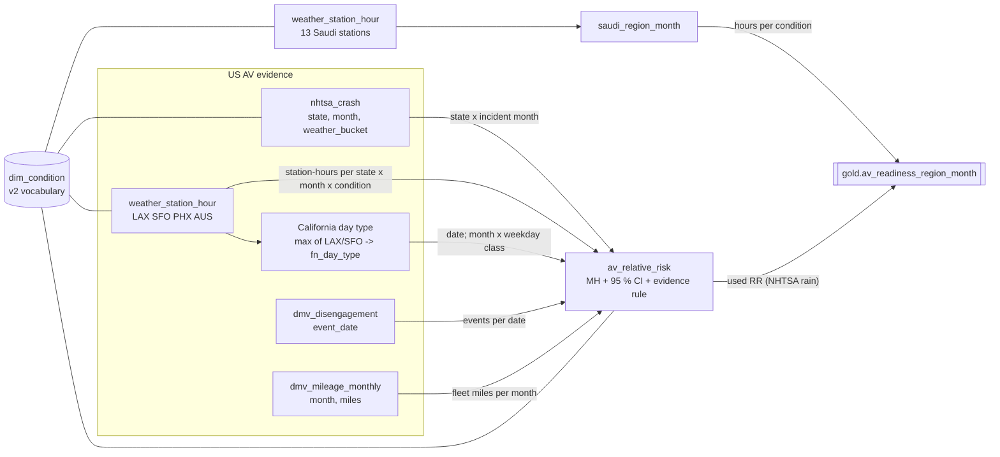
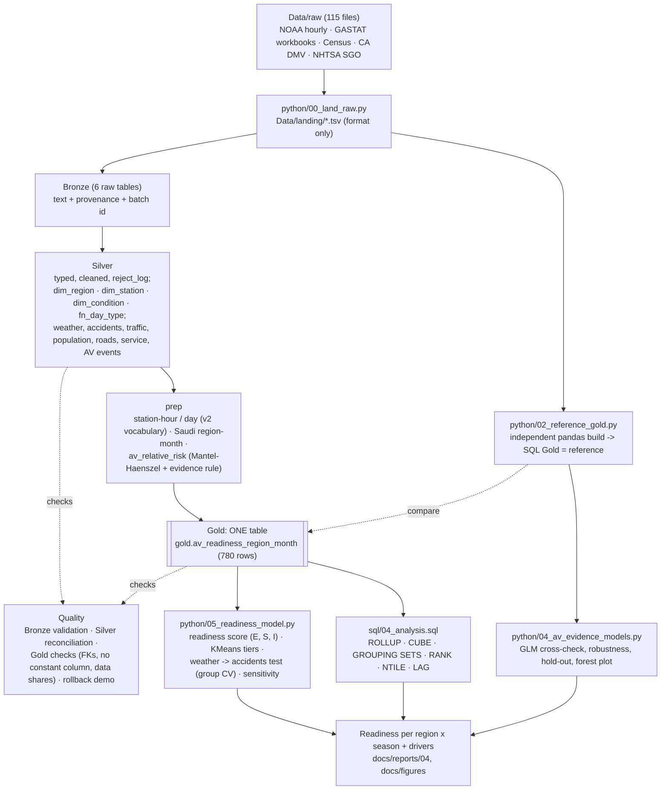

# AV-Ready-Saudi — Entity-Relationship Diagram and Proposed System

Design v2 (28 Nov 2026). Every relation below is a **declared foreign key** in `sql/02_silver.sql` /
`sql/03_gold.sql` (18 FKs; `sql/quality/03_gold_checks.sql` checks that all are enabled and trusted). The two
"logical" relations of the AV evidence (state × month, date × weekday) are strata of the Mantel–Haenszel ratios and are
shown in the second diagram. Bronze tables are raw text with provenance and have no keys by design.

## 1. ERD — Silver, prep and Gold

```mermaid
erDiagram
    dim_region ||--o{ region_alias : "spelling of"
    dim_region ||--o{ dim_station : "has station"
    dim_region ||--o{ accidents_region_year : "accidents per year"
    dim_region ||--o{ roads_region_year : "roads per year"
    dim_region ||--o{ population_region_year : "population per year"
    dim_region ||--o{ traffic_region_month : "traffic per month"
    dim_region ||--|| region_service_2025 : "service 2025"
    dim_region ||--o{ saudi_region_month : "weather per month"
    dim_region ||--o{ av_readiness_region_month : "GOLD row per month"
    dim_station ||--o{ weather_obs : "reports"
    dim_station ||--o{ weather_station_hour : "hours"
    dim_station ||--o{ weather_station_day : "days"
    dim_station ||--o{ saudi_region_month : "station of region"
    dim_station ||--o{ av_readiness_region_month : "weather_station_id"
    dim_condition ||--o{ weather_station_hour : "hour_bucket"
    dim_condition ||--o{ weather_station_day : "day_type"
    dim_condition ||--o{ nhtsa_crash : "weather_bucket"
    dim_condition ||--o{ av_relative_risk : "condition_code"

    dim_region {
        CHAR3 region_code PK
        NVARCHAR region_name_en
        NVARCHAR region_name_ar
    }
    region_alias {
        NVARCHAR alias_key PK
        CHAR3 region_code FK
    }
    dim_station {
        CHAR11 station_id PK
        CHAR2 country "SA or US"
        CHAR3 region_code FK "SA stations"
        CHAR2 us_state "US stations"
        VARCHAR tz_name
    }
    dim_condition {
        VARCHAR condition_code PK "dust haze_dry fog_moist rain normal ..."
        VARCHAR factor "weather or light"
        TINYINT priority
        NVARCHAR rule_text "WMO METAR dew-point rule"
        VARCHAR us_av_coverage "uncovered covered reference"
    }
    weather_obs {
        CHAR11 station_id PK,FK
        DATETIME2 obs_utc PK
        VARCHAR report_type PK
        DECIMAL temp_c
        DECIMAL dew_c
        DECIMAL dew_spread_c
        BIT is_dust_haze_fog_rain_low_vis_night
        BIT is_hot40_hot45
    }
    accidents_region_year {
        CHAR3 region_code PK,FK
        SMALLINT data_year PK
        INT serious_accidents
        INT deaths
        INT injuries
    }
    roads_region_year {
        CHAR3 region_code PK,FK
        SMALLINT data_year PK
        DECIMAL road_km_per_1000_people
        DECIMAL intercity_divided_share
    }
    population_region_year {
        CHAR3 region_code PK,FK
        SMALLINT data_year PK
        INT population
        VARCHAR population_basis "census_2022_table or gastat_rate_implied"
    }
    traffic_region_month {
        CHAR3 region_code PK,FK
        DATE month_start PK
        DECIMAL adt_per_point
        DECIMAL traffic_month_index
    }
    region_service_2025 {
        CHAR3 region_code PK,FK
        INT response_within_s
        INT response_outside_s
        BIGINT registered_vehicles
    }
    nhtsa_crash {
        NVARCHAR report_id PK
        CHAR2 us_state
        DATE incident_month
        VARCHAR weather_bucket FK
        BIT in_scope
    }
    dmv_disengagement {
        BIGINT disengagement_id PK
        DATE event_date
        NVARCHAR manufacturer
    }
    dmv_mileage_monthly {
        NVARCHAR permit_number PK
        NVARCHAR vin PK
        DATE month_start PK
        DECIMAL miles
    }
    weather_station_hour {
        CHAR11 station_id PK,FK
        DATETIME2 hour_local PK
        DECIMAL min_dew_spread_c
        BIT is_fog_moist_haze_dry
        VARCHAR hour_bucket FK
    }
    weather_station_day {
        CHAR11 station_id PK,FK
        DATE local_date PK
        INT hours_per_condition
        VARCHAR day_type FK "silver.fn_day_type"
    }
    saudi_region_month {
        CHAR3 region_code PK,FK
        DATE month_start PK
        CHAR11 station_id FK
        INT hours_per_condition
        INT days_per_type
    }
    av_relative_risk {
        VARCHAR event_source PK "nhtsa_crash dmv_disengagement"
        VARCHAR factor PK
        VARCHAR condition_code PK,FK
        FLOAT rr_crude
        FLOAT rr_adjusted "Mantel-Haenszel"
        FLOAT ci_low
        FLOAT ci_high
        BIT used_in_index
    }
    av_readiness_region_month {
        CHAR3 region_code PK,FK
        DATE month_start PK
        CHAR11 weather_station_id FK
        DECIMAL share_v2_conditions "dust haze_dry fog_moist rain normal"
        DECIMAL traffic_month_index
        INT acc_year_serious "annual, repeat on 12 months"
        INT population
        DECIMAL env_readiness
        DECIMAL env_readiness_cons
        DECIMAL av_crash_multiplier
    }
```

Cardinalities: one region has many stations-over-time rows, one row per year in each annual table, one row per month in
traffic and Gold, and exactly one service row (2025). One station has many reports, hours and days. One condition
classifies many hours, days, crashes and relative-risk rows. Gold has exactly 13 × 60 = 780 rows.

## 2. How the AV evidence meets Saudi weather (strata of the relative risks)

## 3. Proposed system (end to end)

