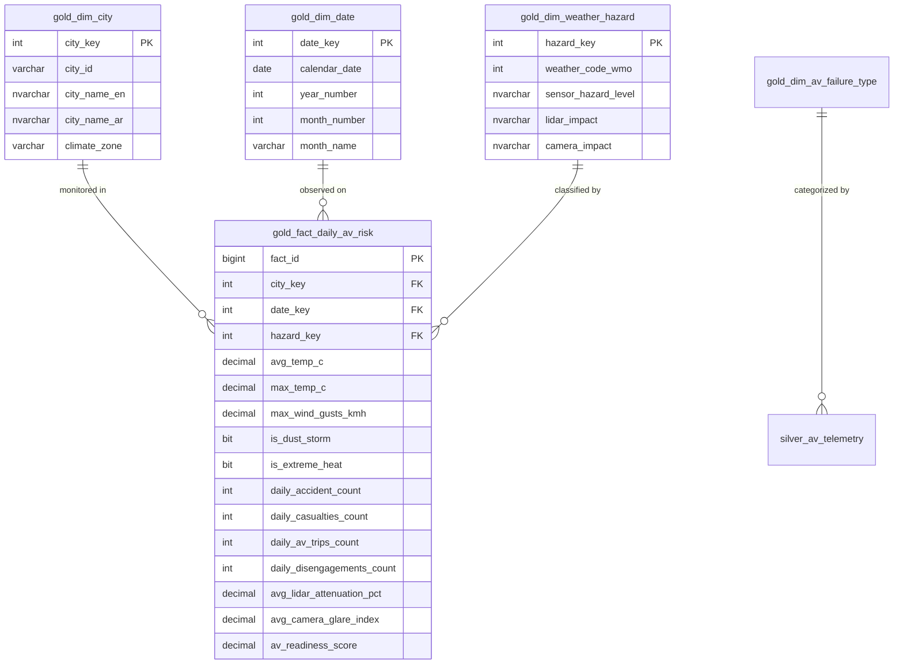

# تقرير الطبقة الذهبية (Gold Layer Report)

**المشروع:** AV-Ready-Saudi  
**المقرر:** مستودعات البيانات والتنقيب (Data Mining & Data Warehousing)  
**الطبقة:** Gold Layer (Dimensional Star Schema & Business Marts)  
**قاعدة البيانات:** `av_ready_saudi_dw`  
**الـ Schema المستهدف:** `gold.*`  

---

## 1. الهدف المعماري للطبقة الذهبية (Architectural Objective)
تحويل البيانات المؤسسية الموثوقة من الطبقة الفضية إلى **نموذج بعدي نجمي (Dimensional Star Schema)** يدعم الاستعلامات التحليلية التجميعية (OLAP Cubes) وحساب مؤشرات الأداء الرئيسية (KPIs)، مع الالتزام بالقاعدة الصارمة للمقرر: **توثيق دقة السجل (Grain) لكل جدول حقائق صراحةً**.

---

## 2. معمارية النموذج النجمي (Star Schema Architecture)

---

## 3. جداول الأبعاد (Dimensions Catalog)

1. **`gold.dim_city` (بعد المدن):**
   * *المفتاح البديل:* `city_key (INT IDENTITY)`.
   * *المحتوى:* 10 مدن سعودية مع الإحداثيات الجغرافية وتصنيف النطاق المناخي (`DESERT_CONTINENTAL`, `COASTAL_HUMID_DUST`, `ARID_VALLEY_HEAT`, `HIGHLAND_TEMPERATE`).
2. **`gold.dim_date` (بعد التاريخ):**
   * *المفتاح البديل:* `date_key (INT)` بصيغة `YYYYMMDD` (مثال: `20240715`).
   * *المحتوى:* 2,192 يوماً تقويمياً فريداً (2019 إلى 2024) مع مكونات السنة والشهر واسم الشهر والربع السنوي.
3. **`gold.dim_weather_hazard` (بعد مخاطر الطقس والحساسات):**
   * *المفتاح البديل:* `hazard_key (INT IDENTITY)`.
   * *المحتوى:* تصنيف أكواد الطقس الدولية WMO إلى مستويات خطورة حساسات (`LOW`, `MEDIUM`, `HIGH`, `CRITICAL`) وتأثيرها على الليزر والكاميرات.
4. **`gold.dim_av_failure_type` (بعد كتالوج أعطال القيادة الذاتية):**
   * *المفتاح البديل:* `failure_type_key (INT IDENTITY)`.
   * *المحتوى:* تصنيف الأعطال حسب المنظومة الفرعية (`PERCEPTION_LIDAR`, `PERCEPTION_CAMERA`, `COMPUTE_HARDWARE`, `CHASSIS_TIRE`).

---

## 4. جدول الحقائق ومؤشر الجاهزية (Fact Table & Readiness KPI)

* **اسم الجدول:** `gold.fact_daily_av_risk`
* **دقة السجل الإلزامية (GRAIN):** 
  > **"سجل واحد فقط لكل مدينة في كل يوم تقويمي محدد (Exactly ONE row per city per observation date)."**
* **عدد الصفوف الناتجة:** **21,920 صفاً** ($10 \text{ مدن} \times 2,192 \text{ يوماً}$).

### معادلة مؤشر الجاهزية التشغيلي المركب (`av_readiness_score` من 0 إلى 100):
تم بناء المؤشر ليعبر عن جاهزية الطريق لمركبات الـ AV بدقة:
$$\text{Readiness Score} = 100.0 - \underbrace{(35.0 \times \text{Dust}) - (20.0 \times \text{Heat}_{>45}) - (15.0 \times \text{Wind}_{>50}) - (5.0 \times \text{Accidents})}_{\text{عوامل البيئة الواقعية (70\%)}} - \underbrace{(8.0 \times \text{Disengagements})}_{\text{استجابة الحساسات (30\%)}}$$

* **مؤشر 90 إلى 100:** ظروف مثالية لقيادة ذاتية كاملة (Optimal Driving Conditions).
* **مؤشر 60 إلى 89:** مخاطر متوسطة تتطلب الحذر وتفعيل حساسات المساندة (Moderate Environmental Risk).
* **مؤشر أقل من 60:** مخاطر حرجة تستوجب تعليق القيادة الذاتية أو تسليم التحكم البشري (High Hazard / Operations Restricted).

---

## 5. جاهزية الطبقة الذهبية لدعم القرار والتنقيب
* تم توفير فيوز التعدين الموثقة في `sql/05_feature_views.sql`:
  * `gold.features_city_monthly`: لتجميع وتصنيف مدن وشهور المملكة (K-Means Clustering).
  * `gold.features_trip_telemetry`: للتنبؤ بأعطال وانفصال النظام الذاتي (Decision Tree Classification).
* تم ربط مؤشرات الأداء في الطبقة الدلالية `semantic.*` للإجابة المباشرة عن الأسئلة التحليلية في `sql/06_analytics.sql`.
